## About Me

Product background, now building AI applications.
Working on knowledge-management tooling and agent infrastructure.

- Consolidating skills scattered across tool directories into a single source of truth
- Restructuring an Obsidian vault into an agent-retrievable knowledge base
- TypeScript for frontends and CLIs, Python for scripts and data pipelines

## Tech Stack

## Current Focus

| Focus | What I'm doing |
|:--|:--|
| **Agent skill library** | Building a local skill library — 180+ skills consolidated into one source of truth, distributed to multiple CLI clients via junctions |
| **Knowledge-base engineering** | AI-first refactor of an Obsidian vault: structured frontmatter, a traversable wikilink graph, and agent-facing retrieval protocols |
| **AI application development** | Learning by building. TypeScript for frontends and CLIs, Python for scripts and data pipelines |

## What I'm Working On

**Skill consolidation**
Merging skills scattered across tool directories into a single source of truth. The hard part isn't copying files — it's that Windows junctions are transparent: any tool that clears its own skills directory wipes the source too.

**The knowledge base as agent context**
Notes aren't written for people to read — they're written for future agents to retrieve. Each note carries its own summary, sources, and confidence level, so an agent with zero context can judge relevance in 10 seconds.

**Validating from zero**
No client work, no capability arms race. Build something priceable first, then talk about the rest.

## Activity

---

Profile README lives in <a href="https://github.com/NixRonox/NixRonox">NixRonox/NixRonox</a>

